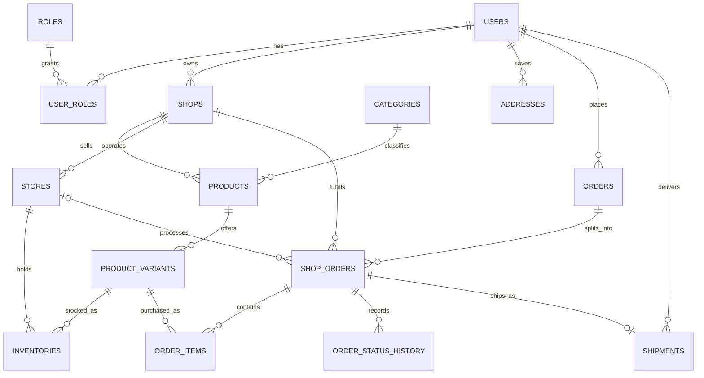

# H2T domain model — phase 2.5

Shop is a vendor's online business; Store is a physical branch belonging to that
Shop. A Product is a shirt design belonging to one Shop and one Category.
ProductVariant identifies its SKU, size and color. Inventory remains a quantity
for one Store + ProductVariant pair.

## Relationships



| Entity / table | Ownership and purpose |
| --- | --- |
| User / users | Owns shared roles through user_roles; unchanged account model |
| Role / roles | RoleName enum: ROLE_USER, ROLE_VENDOR, ROLE_MANAGER, ROLE_ADMIN, ROLE_SHIPPER |
| Shop / shops | Required owner_id to User; unique slug; name, description, contacts, enabled and status |
| Category / categories | Product classification; category names need not be unique |
| Product / products | Required shop_id and category_id; inverse variants collection |
| ProductVariant / product_variants | Required product_id; unique SKU and (product_id, size, color) |
| Store / stores | Required shop_id; physical branch with unique code |
| Inventory / inventories | Required store_id and product_variant_id; pair unique; quantity nonnegative |
| OrderEntity / orders | Customer's aggregate: user_id, order date, total, recipient/address snapshots and audit timestamps |
| ShopOrder / shop_orders | Required order_id and shop_id; optional store_id; amounts and per-shop status; unique (order_id, shop_id) |
| OrderItem / order_items | Required shop_order_id and product_variant_id; immutable-by-convention purchase snapshots |
| OrderStatusHistory / order_status_history | Required shop_order_id, status, UTC changedAt and optional note |
| Shipment / shipments | Required shop_order_id and shipper_id to User; assignment/pickup/delivery times, optional provider and status |
| Address / addresses | Required user_id; recipient, phone, address line, ward, district, city, isDefault and audit timestamps |

Guest means unauthenticated access and has no persisted role. There is no role or
account seeding. RoleName centralizes application role values; the SQL migration
necessarily repeats persisted enum literals to update the existing database CHECK.

All associations are LAZY. Every reference is required except ShopOrder.store,
which can be selected later. Shipment uses a unidirectional LAZY many-to-one
mapping with a UNIQUE shop_order_id: at most one shipment per shop order in this
phase. Reassignment may update that record; multiple delivery attempts and an
assignment audit trail are outside this model.

Only useful inverse collections are present: Product.variants,
OrderEntity.shopOrders and ShopOrder.items. Other one-to-many relations are
represented by their owning side and repository queries. Use
ProductVariant.setProduct, OrderEntity.addShopOrder and ShopOrder.addItem to
synchronize both sides. Collections expose read-only views. A ShopOrder cannot
move to another order; an OrderItem cannot move to another ShopOrder.

## Statuses, data types and history

- ShopStatus: PENDING, ACTIVE, SUSPENDED, REJECTED.
- OrderStatus (on ShopOrder and OrderStatusHistory): NEW, CONFIRMED, PICKED_UP,
  SHIPPING, DELIVERED, CANCELLED, RETURN_REQUESTED, RETURNED, REFUNDED.
- ShipmentStatus: ASSIGNED, PICKED_UP, SHIPPING, DELIVERED, CANCELLED.

All enums, including RoleName, persist as STRING. Monetary values use BigDecimal,
precision 19 and scale 2, with nonnegative validation and SQL CHECK constraints.
ShopOrder.shippingFee and discountAmount default to zero. ProductVariant.price
is optional; null means the future purchasing service resolves Product.basePrice.

All entities inherit a Long IDENTITY key. AuditableEntity supplies UTC createdAt
and updatedAt for User, Category, Product, Store, Shop, OrderEntity, ShopOrder and
Address. Inventory maintains updatedAt; orderDate, changedAt and assignedAt are
initialized on persist. Pickup/delivery timestamps remain null until supplied.
Bulk SQL writers must maintain timestamps explicitly.

Vietnamese text uses @Nationalized (SQL Server nvarchar); timestamps use datetime2,
booleans bit, and IDs bigint identity. Required strings use NotBlank and length
validation. Database collation determines SQL Server case/accent uniqueness.

OrderItem snapshots productName, variantSku, size, color, quantity, unitPrice and
subtotal. Catalog changes do not overwrite those snapshots. OrderEntity stores
recipient/address text independently of Address, so editing an address does not
rewrite an existing order.

PERSIST/MERGE cascade only from OrderEntity to ShopOrder and from ShopOrder to
OrderItem. No REMOVE, ALL or orphan removal is configured. Foreign keys protect
history; disabling a Shop or Product does not delete its orders. Referenced users,
shops, variants, orders and shop orders cannot be deleted through a cascade.

## Required rules for the future Service layer

The following cross-entity business rules are documented here, not implemented
as controllers, services or complex database constraints in this phase:

- Shop.owner must have ROLE_VENDOR; Shipment.shipper must have ROLE_SHIPPER.
- Inventory.store.shop must equal Inventory.productVariant.product.shop.
- If selected, ShopOrder.store.shop must equal ShopOrder.shop.
- Every OrderItem.productVariant.product.shop must equal its ShopOrder.shop.
- Compute line subtotals, ShopOrder subtotal + shippingFee - discountAmount,
  and aggregate Order total consistently; validate discounts and status transitions.
- Record status history when implementing transitions; current repositories only
  prepare persistence. Keep historical snapshots stable through the application API.
- Enforce the chosen single-default-address rule per user transactionally.
- Apply vendor ownership, manager/admin multi-shop access and shipper assignment
  authorization when the business/security layers are introduced.

## Repositories

All 14 entities have JpaRepository interfaces. Existing unique lookups remain.
RoleRepository.findByName now takes RoleName rather than String.

| Repository | Added queries |
| --- | --- |
| ShopRepository | findBySlug, findByOwnerId |
| ProductRepository | findByShopId |
| StoreRepository | findByShopId |
| ShopOrderRepository | findByShopId, findByOrderId |
| OrderStatusHistoryRepository | findByShopOrderIdOrderByChangedAtAscIdAsc |
| ShipmentRepository | findByShopOrderId, findByShipperId |
| AddressRepository | findByUserId |

Entities and repositories remain below com.example.demo, the root of
DemoApplication. No extra EntityScan or repository scanning configuration is needed.

## Safe local upgrade from phase 2

Hibernate update creates missing tables/columns, but does not safely reinterpret
the old Order -> Store / OrderItem -> Order model or replace an existing role CHECK.
The old unmapped NOT NULL orders.store_id, orders.status and order_items.order_id
would prevent inserts from the new mappings. Existing role validation allowed
only ROLE_USER and ROLE_ADMIN.

The inspected local H2T_DB had zero rows in all ten phase-2 tables. The reviewed
[pre-update migration](sql/phase-2.5-local-pre-update.sql) is for that empty legacy
baseline. Stop older app instances and execute it against H2T_DB before the first
phase-2.5 startup. It is not automatically run by Spring; SQL initialization stays
disabled. A fresh database can be created by Hibernate update without this script.

The script checks the database name and refuses populated legacy catalog/orders
that require ownership, order splitting, status or audit backfill. It uses a
transaction, XACT_ABORT and guarded ALTER statements. It changes the three legacy
columns to nullable and replaces only the roles CHECK with the five allowed roles.
It deletes no rows, columns or tables. It can be rerun after the upgrade.

Hibernate then creates shops, shop_orders, order_status_history, shipments and
addresses; adds products.shop_id, stores.shop_id, order_items.shop_order_id and
orders.created_at/updated_at; and creates the corresponding keys and constraints.
Legacy nullable columns and their constraints remain only for compatibility and
are not mapped by JPA. New statuses are stored in shop_orders and history; the
unmapped legacy orders.status keeps its previous CHECK. No status conversion was
needed because there were no historical rows. For a populated installation,
prepare an explicit owner/backfill and status mapping before this upgrade; do not
remove the guards or guess business ownership.

The base profile uses ddl-auto=none. Local dev uses ddl-auto=update and
hibernate.hbm2ddl.halt_on_error=true. The ignored root application-local.properties
selects dev and supplies credentials for localhost:1433/H2T_DB. Passwords stay
outside tracked source and the WAR. No create/create-drop runtime mode is used.

## Verification

The 60 automated tests cover the existing foundation, catalog, inventory, unique
keys, snapshots, audit and deletion protections plus every role, shop status,
order status and shipment status; vendor ownership; multiple shops, branches,
products and addresses; multi-shop orders; history; shipper assignment; required
ownership and lazy loading. H2 is test-only, uses update against an in-memory
database, and persistence tests roll back their transactions.

SqlServerSchemaTests generates review-only DDL at target/sqlserver-schema.sql.
Its schema script action creates a text artifact; its database action is none.
It does not execute CREATE TABLE or connect to SQL Server.

On 2026-09-13, actual SQL Server JDBC metadata verified all 15 dbo tables, the
11 main new foreign keys (enabled, trusted, no delete cascades), required new
columns, database H2T_DB and TCP port 1433. A transactional JDBC write exercised
all five roles, a two-shop order, catalog, inventory, addresses, history and
shipments, then rolled back. All original row counts remained zero; SQL Server
IDENTITY counters may advance after rolled-back inserts.

For a direct SSMS recheck:

```sql
USE H2T_DB;
SELECT DB_NAME() AS database_name;
SELECT s.name AS schema_name, t.name AS table_name
FROM sys.tables t JOIN sys.schemas s ON s.schema_id = t.schema_id
ORDER BY s.name, t.name;
SELECT OBJECT_NAME(parent_object_id) AS child_table,
       OBJECT_NAME(referenced_object_id) AS parent_table,
       name, is_disabled, is_not_trusted, delete_referential_action_desc
FROM sys.foreign_keys ORDER BY child_table, name;
```

Authentication, OTP, business services, controllers, frontend, cart, payments,
shipping workflows, WebSocket and Cloudinary implementation remain outside phase 2.5.
